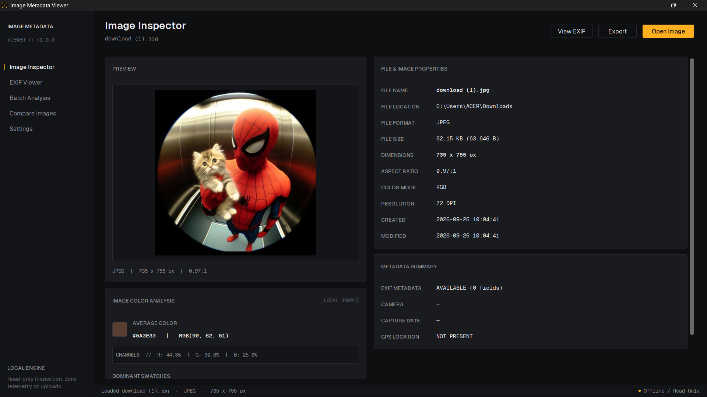

# Image Metadata Viewer

A local desktop utility for inspecting image properties, EXIF metadata, color distributions, and batch folder statistics.




## Download

Grab the latest .exe from the [Releases page](https://github.com/arunbhatt1/image-metadata-viewer/releases). No Python needed.

## Features

- Runs 100% offline with zero network requests and zero telemetry.
- Opens files read-only: original images and embedded EXIF tags are never modified, resized, or stripped.
- Nothing is uploaded; all metadata parsing and pixel analysis happen locally in memory.
- **Image Inspector**: Displays an orientation-adjusted preview and inspects the loaded image:
  - File properties: name, location, format, byte size, pixel dimensions, aspect ratio, color mode, DPI/PPI resolution, and filesystem timestamps.
  - EXIF/GPS summary: metadata presence status and GPS tag indicator.
  - Color analysis: average RGB/HEX values, RGB channel distribution, and 5 dominant color swatches.
- **EXIF Viewer**: Organizes existing tags into Camera Information, Exposure Information, Date and Time, Location Information, and Image Information, with live search, raw tag toggle, GPS privacy notice, Copy Value, and Copy All.
- **Batch Analysis**: Scans multiple images or entire folders on a background thread with progress updates, cancellation, summary metrics, format/EXIF/GPS filters, and a sortable results table.
- **Compare Images**: Side-by-side previews and property diff table highlighting differences between two selected images.
- **Export**: Exports single-image or batch metadata to JSON or CSV with destination selection and overwrite confirmation.
- **Settings**: Switches between Dark, Light, and System themes, configures default export format and preview size, and clears in-memory session history.

## Supported Formats

- **Built-in**: `JPG`, `JPEG`, `PNG`, `WEBP`, `TIFF`, `TIF`, `BMP`, `GIF`
- **Optional**: `HEIC`, `HEIF` (automatically enabled when `pillow-heif` is installed)

## Installation

Requires Python 3.12+ (enforced by pinned dependencies such as `numpy==2.5.4`).

1. Clone the repository:

   ```bash
   git clone https://github.com/arunbhatt1/image-metadata-viewer.git
   cd image-metadata-viewer
   ```

2. Create a virtual environment:

   ```bash
   python -m venv .venv
   ```

3. Activate the virtual environment:

   - **Windows (PowerShell)**:

     ```powershell
     .\.venv\Scripts\Activate.ps1
     ```

   - **macOS / Linux**:

     ```bash
     source .venv/bin/activate
     ```

4. Install dependencies:

   ```bash
   pip install -r requirements.txt
   ```

   *(Optional)* For HEIC/HEIF support:

   ```bash
   pip install pillow-heif
   ```

## Usage

Run the application from the repository root:

```bash
python main.py
```

### Pages Overview

- **Image Inspector**: Click **Open Image** (or press `Ctrl+O`) to load an image and view its preview, file properties, EXIF/GPS status, and color swatches.
- **EXIF Viewer**: Inspect structured EXIF fields for the loaded image, filter with the search bar, toggle **RAW TAGS** for original tag names, or copy values to the clipboard.
- **Batch Analysis**: Choose **Select Images** or **Select Folder** to scan files asynchronously, filter by format/EXIF/GPS, click column headers to sort, or double-click a row to open it in the Inspector.
- **Compare Images**: Load **Image A** and **Image B** to inspect previews side-by-side and highlight differing properties.
- **Settings**: Switch between **Dark**, **Light**, and **System** themes, set the default export format (`JSON` or `CSV`), adjust preview size, or clear the current session.

To install development dependencies and run the automated test suite:

```bash
pip install -r requirements-dev.txt
pytest -v
```

## Build an Executable

Install development dependencies (which include PyInstaller) in your active environment and build a windowed single-file Windows executable:

```powershell
pip install -r requirements-dev.txt
pyinstaller --noconfirm --onefile --windowed --name "Image Metadata Viewer" --icon "app/assets/app_icon.ico" --add-data "app/assets;app/assets" --collect-all customtkinter main.py
```

The compiled executable lands at:

```text
dist/Image Metadata Viewer.exe
```

## Project Structure

```text
image-metadata-viewer/
├── main.py
├── requirements.txt
├── requirements-dev.txt
├── pytest.ini
├── LICENSE
├── README.md
├── docs/
│   └── README.md
├── app/
│   ├── application.py
│   ├── config.py
│   ├── assets/
│   │   ├── app_icon.ico
│   │   └── fonts/
│   ├── core/
│   │   ├── batch_processor.py
│   │   ├── color_analyzer.py
│   │   ├── exif_parser.py
│   │   ├── exporter.py
│   │   ├── image_loader.py
│   │   └── metadata_extractor.py
│   ├── ui/
│   │   ├── batch_page.py
│   │   ├── compare_page.py
│   │   ├── components.py
│   │   ├── exif_page.py
│   │   ├── inspector_page.py
│   │   ├── settings_page.py
│   │   ├── sidebar.py
│   │   └── theme.py
│   └── utils/
│       ├── file_utils.py
│       └── formatters.py
└── tests/
    ├── conftest.py
    ├── test_batch.py
    ├── test_color_analysis.py
    ├── test_config.py
    ├── test_exif.py
    ├── test_exporter.py
    └── test_metadata.py
```

## Privacy

All image decoding, EXIF parsing, color analysis, and batch scanning execute strictly locally on your machine. Files are opened read-only and are never altered, no network libraries are imported or called, and the local settings file stores only UI preferences (theme, default export format, and preview size) without image contents or GPS coordinates.

## Roadmap

- Optional EXIF/GPS metadata stripping into a separate sanitized copy
- Offline GPS coordinate preview with reverse-geocoding lookup table
- Drag-and-drop file loading
- Camera RAW container support (e.g., CR3, NEF, ARW) via optional decoder

## License

MIT License. See [LICENSE](LICENSE) for details.
